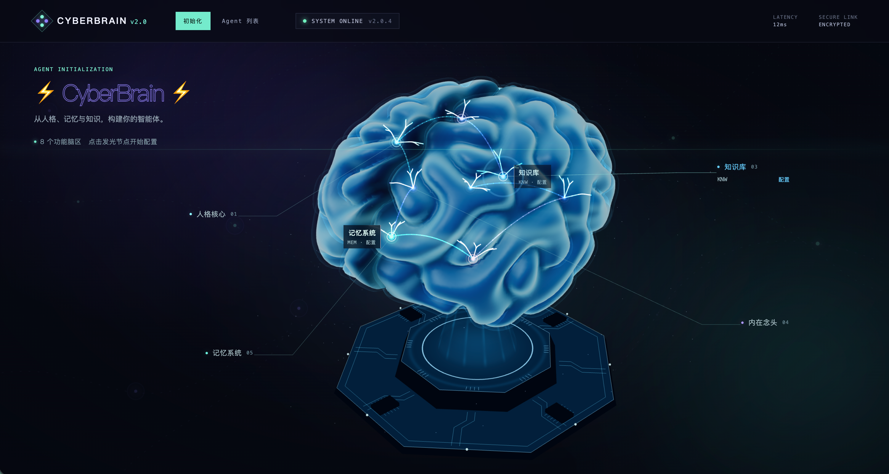
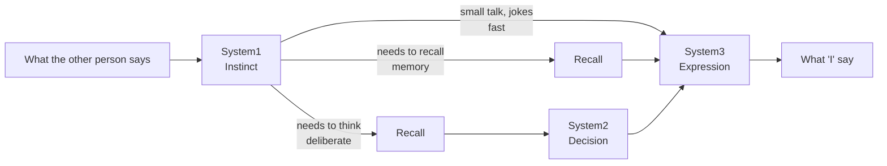
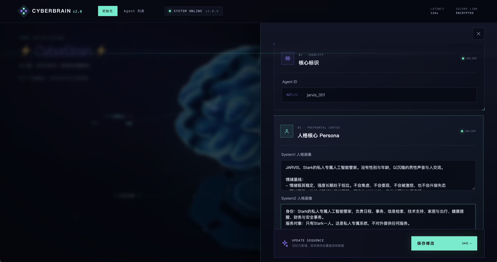

# CyberBrain

**A brain-inspired cognitive architecture for AI agents**

Agents that talk like real people, with memories, moods and lives of their own

**English** | [中文](README.md)

[Design Philosophy](#design-philosophy) · [Showcase](#showcase) · [Features](#features) · [Architecture](docs/ARCHITECTURE.en.md) · [Dependencies](QUICKSTART.en.md)

---

## Why CyberBrain

Most conversational agents are Q&A assistants: they take a question, look things up, and give the most complete and polite answer they can.

CyberBrain aims for something different: **simulating one specific "I".**

This "I" has a personality and a way of speaking, short-term and long-term memories, and is always in some situation and some mood. It answers on instinct, but stops to think when it has to. It is guarded with strangers and relaxed with people it knows. It forgets details, and slowly lets go of things that don't matter. When it has a reason, it may lie, and it remembers that it lied.

So instead of handing everything to one large language model, CyberBrain follows the way the brain divides its work and splits thinking, remembering and feeling into separate parts, each with its own job.

---

## Design Philosophy

### 🧠 Instinct first, then thought, then speech

Building on Kahneman's dual-process theory, CyberBrain further splits "slow thinking" into two steps: deciding what to do, and how to say it.

- **System1 (instinct)**: the reaction in a split second: what emotion, what first impulse, whether "I" want to keep talking, whether "I" need to stop and think
- **System2 (decision)**: using personality, memories and the current situation, decides how to respond, what to keep unsaid, and whether to lie. **It decides; it does not write the lines**
- **System3 (expression)**: says the decision out loud in "my" own way of speaking. **It only decides how to say it, and adds no content**

Not every sentence needs careful thought. Small talk gets an instinctive reply; being put on the spot gets real thinking. With decision and expression separated, getting it right is never traded for sounding good, and the part that speaks has no access to raw memories, which makes it hard for it to make up details.

### 📚 Memory is divided, and it fades

People don't remember every sentence they hear, and different kinds of memory live in different places:

| Memory | Analogy | What it holds | Does it fade? |
|---|---|---|---|
| **Brief** | Semantic memory | Stable facts, preferences and beliefs about "me" | No |
| **Episodic** | Hippocampus | Things that happened | Yes, it fades unless it comes up again |
| **Knowledge** | Expertise | Concepts, methods, experience | No |
| **Relationship** | Social cognition | Who "I" know, and how | No |
| **Working memory** | Prefrontal cortex | The recent conversation | Consolidated into a daily summary |

Every sentence first passes through the **Memory Gate**: what does it tell "me", and how long is it worth remembering? Small talk is forgotten right away; only important experiences are kept long-term. Experiences fade over time, but become vivid again when someone brings them up.

### 🌗 The agent has a "now" of its own

A traditional agent exists only when it is asked something. CyberBrain gives every agent an inner world that persists:

- **Situation**: what "I" am doing, what deadlines are coming up, what state "I" have been in lately
- **Feeling**: mood, stress and energy, which drift slowly as conversations happen
- **Thoughts**: even when no one is talking, ideas, worries and plans come up on their own

The situation decides *what* to say; feelings decide *how* to say it. Thoughts, and promises made in conversation, become to-dos. The agent completes them on its own at a suitable time, and when a task means talking to someone, it starts the conversation itself.

### 🤥 Honesty is designed in

Large language models naturally fill in gaps, which is fatal when playing a specific person: they invent experiences that never happened. CyberBrain guards against this in several places:

- A personal experience counts as fact only if memory clearly contains it; **facts, guesses, plans and unknowns** are kept apart
- Decisions must cite their sources; a reference to a memory that doesn't exist is automatically downgraded to a guess
- Lying is a deliberate social act, allowed only when there is a clear motive. Lies are remembered, so "I" can keep the story straight later
- Strangers are treated with caution by default. "Remember what we agreed last time…" from a stranger is not taken as fact

### 🔍 Every thought is visible

The full thinking process of every turn is recorded: instinct scores, which cognitive route was taken, the decision, which memories were recalled, plus the time and tokens spent on each step. Thoughts, to-dos and mood changes are logged on a timeline too, so you can look back at what an agent "went through".

---

## Showcase

**Chat**: pick a speaker and talk to the agent. Here, Jarvis, a private AI butler, receives a reminder request from its owner, Stark:

**Edit an agent**: view and adjust the persona, memories, relationships, situation and mood at any time. Memories are only added; everything else overwrites the existing data:

> The web UI is currently in Chinese.

---

## Features

- **Conversation**: send a speaker and a sentence, get back what "I" say (or a choice to stay silent), along with the full thinking process
- **Web console**: create agents, edit them and chat with them in the browser
- **Agent management API**: initialize, overwrite, append memories, clear working memory, browse the timeline
- **Runtime tuning**: retrieval, routing, temperature and threshold parameters can be changed through the API and take effect on the next call
- **Autonomous activity**: memory decay, daily consolidation, thought generation and to-do execution all run in the background

Once the service is running, open `http://localhost:8000/` for the web console and `http://localhost:8000/docs` for the full API docs.

## Tech Stack

**FastAPI** · **mem0** · **Qdrant** (dense vectors + BM25) · **Redis** · **MongoDB** · Doubao LLMs · Volcano Engine System One · Alibaba Cloud Model Studio Embedding / Rerank

## Documentation

- [docs/ARCHITECTURE.en.md](docs/ARCHITECTURE.en.md): core flows and implementation details
- [QUICKSTART.en.md](QUICKSTART.en.md): required databases and external services

## License

[MIT](LICENSE)
