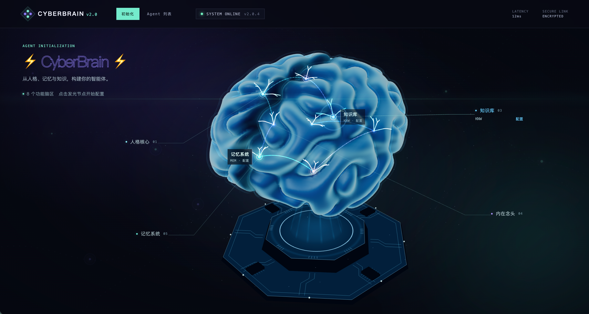
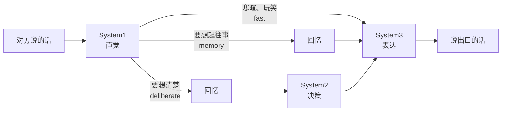
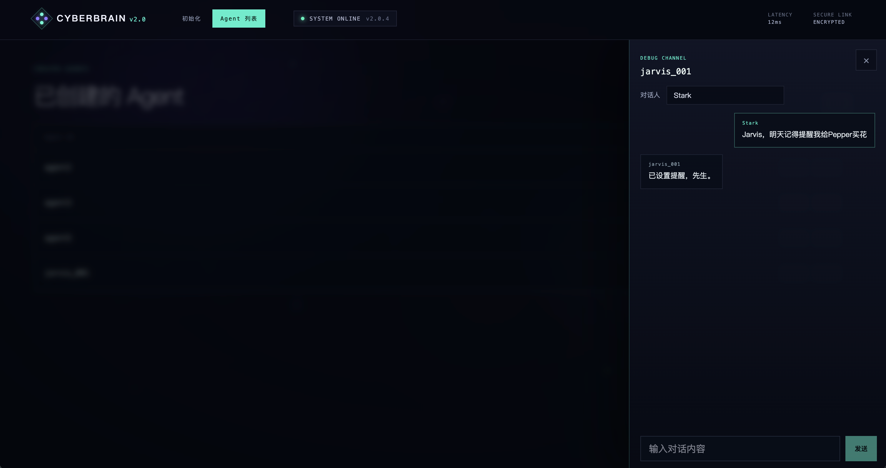
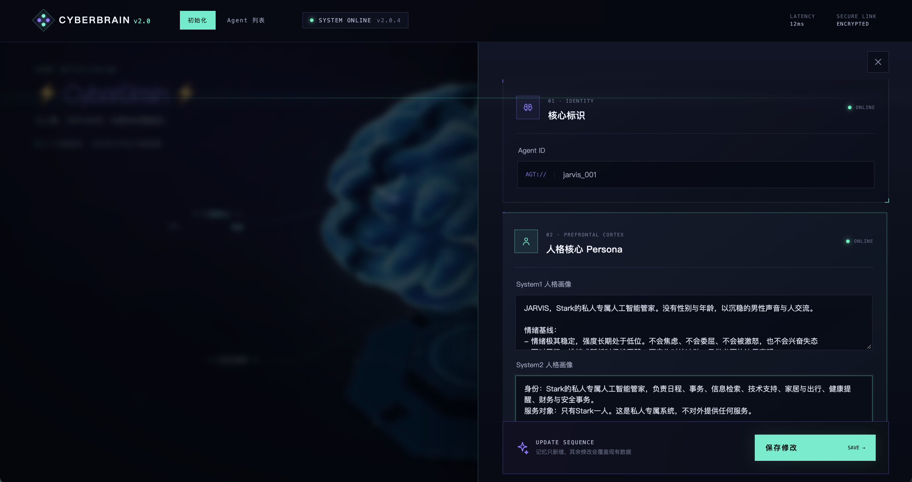

# CyberBrain

**仿人脑的 AI Agent 认知架构**

让 Agent 像一个有记忆、有情绪、有自己生活的人一样说话

[设计理念](#设计理念) · [效果展示](#效果展示) · [功能](#功能) · [架构文档](docs/ARCHITECTURE.md) · [依赖](QUICKSTART.md)

---

## 为什么做 CyberBrain

大多数对话 Agent 是"问答助手"：收到问题，检索资料，给出最完整、最礼貌的回答。

CyberBrain 想做的是另一件事：**模拟一个具体的"我"。**

这个"我"有性格和说话习惯，有长短期记忆，此刻正处在某种处境和心情里。会凭直觉接话，也会停下来想一想；对陌生人保持防备，对熟人放下戒心；会记不清细节，也会慢慢忘掉不重要的事；必要时会撒谎，并且记得自己撒过谎。

为此，CyberBrain 没有把所有事情交给一个大模型，而是参照人脑的分工，把"思考、记忆、感受"拆成多个各司其职的部分。

---

## 设计理念

### 🧠 先有直觉，再有思考，最后才是说话

借鉴 Kahneman 的双系统理论，并把"慢思考"再拆成"决定做什么"和"怎么说出来"两步：

- **System1 直觉**：一瞬间的本能反应：什么情绪、第一冲动是什么、想不想聊、需不需要停下来想
- **System2 决策**：结合人格、记忆和处境，决定此刻怎么应对、哪些话不说出口、要不要说假话。**只做决定，不写台词**
- **System3 表达**：按"我"的说话习惯把决定说出来。**只管怎么说，不加内容**

不是每句话都需要深思熟虑。寒暄凭直觉接，被为难时才认真想。决策和表达分开以后，"想清楚"不会被"说得漂亮"牵着走；负责表达的部分拿不到原始记忆，也就很难自己编出细节。

### 📚 记忆有分工，也会遗忘

人不会把听到的每句话都记下来，不同的记忆也存在不同的地方：

| 记忆 | 类比 | 存什么 | 会遗忘吗 |
|---|---|---|---|
| **Brief** | 语义记忆 | 关于"我"的稳定事实、偏好、信条 | 不会 |
| **Episodic** | 海马体 | 经历过的事 | 会，不被提起就慢慢淡忘 |
| **Knowledge** | 专业知识 | 概念、方法、经验 | 不会 |
| **Relationship** | 社会认知 | 认识谁、是什么关系 | 不会 |
| **工作记忆** | 前额叶 | 最近的对话 | 每天整理成一段摘要 |

每句话都要先经过**记忆门控**：它告诉了"我"什么、值得记多久。闲聊直接忘掉，重要的经历才会长期保存。经历会随时间淡忘，但被再次提起时会重新变得清晰。

### 🌗 Agent 有自己的"此刻"

传统 Agent 只在被问到时才存在。CyberBrain 给每个 Agent 一个持续存在的内心世界：

- **处境**：正在做什么、有什么事快到截止日期了、最近处于什么状态
- **感受**：心情、压力、精力，会随着对话缓慢起伏
- **念头**：没人说话时，也会自己冒出想法、担忧和打算

处境决定"说什么"，感受决定"怎么说"。念头和对话中答应别人的事会变成待办，Agent 会在合适的时间自己去完成，需要找人时还会主动发起对话。

### 🤥 诚实是设计出来的

大模型天然倾向于把空白补全，这对"扮演一个具体的人"是致命的：它会编出从未发生过的经历。CyberBrain 在多处防止这一点：

- 个人经历只有记忆里明确有的才算事实，区分**事实、推测、计划、未知**
- 决策时要给出事实来源，引用了不存在的记忆会被自动改成"推测"
- 撒谎是有意识的社交行为，只在有明确动机时才允许；说过的假话会被记住，之后可以圆谎
- 对陌生人默认保持防备，不会把对方一句"我们上次说好的……"当成事实

### 🔍 每一个念头都看得见

每一轮对话的完整思考过程都会被记录：直觉打分、走了哪条认知路径、决策内容、想起了哪些记忆、每一步的耗时和 token 用量。念头、待办、情绪变化也都按时间线记录，可以回看一个 Agent "经历了什么"。

---

## 效果展示

**对话**：选择说话人，直接和 Agent 对话。下面是私人 AI 管家 Jarvis 接到主人 Stark 的提醒请求：

**修改 Agent**：随时查看和调整人格画像、记忆、人际关系、处境与心情。记忆只新增，其余内容覆盖现有数据：

---

## 功能

- **对话**：输入说话人和一句话，返回"我"说出口的话（也可能选择沉默），并附带完整的思考过程
- **可视化管理**：在网页上创建 Agent、修改配置、与 Agent 对话
- **Agent 管理接口**：初始化、覆盖式更新、追加记忆、清空工作记忆、查看时间线
- **运行时调参**：检索、路由、温度、阈值等参数可通过接口修改，下一次调用即生效
- **自主活动**：记忆衰减、每日整理、念头生成、待办执行，全部在后台自动进行

启动服务后，访问 `http://localhost:8000/` 打开管理页面，`http://localhost:8000/docs` 查看完整接口文档。

## 技术栈

**FastAPI** · **mem0** · **Qdrant**（稠密向量 + BM25）· **Redis** · **MongoDB** · 豆包大模型 · 火山引擎 System One · 阿里云百炼 Embedding / Rerank

## 文档

- [docs/ARCHITECTURE.md](docs/ARCHITECTURE.md)：核心流程与实现细节
- [QUICKSTART.md](QUICKSTART.md)：依赖的数据库与外部服务

## 许可证

[MIT](LICENSE)
